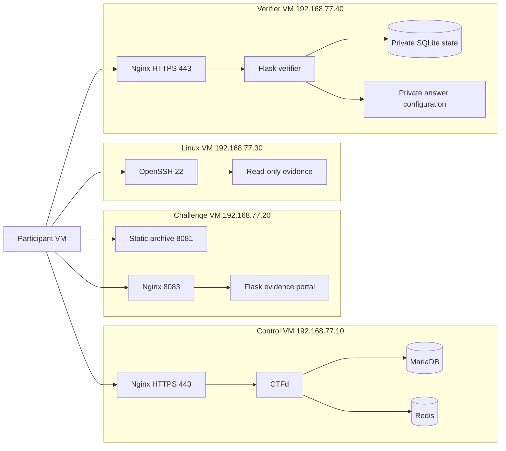

# Architecture and evidence flow

The participant initiates each permitted connection. No application needs cross-VM service access. The verifier returns a flag to the player and does not write to CTFd. CTFd alone owns scoring. The analyst container receives only the Linux evidence tar and authorized public keys; it receives neither private answer configuration nor organizer flags. Database and worker listeners have no published host ports.

```mermaid
flowchart LR
    A[Stage 1 archive match] --> B[Stage 2 original PNG]
    B --> C[Stage 3 approval reference]
    C --> D[Protected cipher and memo]
    D --> E[Stage 4 decrypted image hash]
    E --> F[Organizer issues forensic image]
    F --> G[Stage 5 deleted note and logs]
    G --> H[Trusted manifest hash]
    H --> I[Stage 6 verified manifest]
    I --> J[Verified route bytes]
    J --> K[Four-field verification]
```

Build dependencies run in reverse: route → manifest → forensic evidence → image checksum → encrypted warning. The build register records actual SHA-256 values. Player progression runs forwards using clues and organizer-controlled handovers. Default scores are 100, 100, 200, 200, 250, 300.

Application state is separate from immutable evidence. Portal review state lives in a signed cookie. Verifier teams, attempts and completions live in SQLite, with transactional limits shared across Gunicorn workers. CTFd database/uploads are persistent named volumes. Linux evidence is reconstructed on each container start; its scratch space is temporary and its SSH host keys persist.
